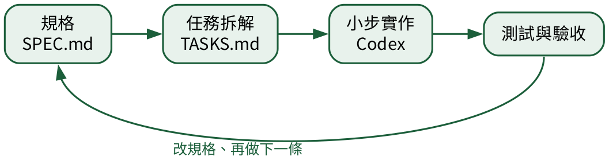

#+TITLE: Vibe Coding 第 1 週：從踩坑到軟體開發
#+AUTHOR: 顏永進
#+SUBTITLE: 試錯 → 什麼是 vibe coding → 什麼是軟體開發 → SDLC
#+LANGUAGE: zh-TW
#+OPTIONS: toc:2 ^:nil num:t
#+PROPERTY: header-args :eval never-export
#+HTML_HEAD: <link rel="stylesheet" type="text/css" href="../css/muse.css" />
#+HTML_HEAD_EXTRA: 

* 老師用：本週流程 :noexport:
| 節次   | 時間   | 段落                                  | 對應章節            |
|--------+--------+---------------------------------------+---------------------|
| 第 1 節 | 0–25   | 互打 App，結果分三欄貼 Padlet（20 分各組 Reboot） | 一、互打 App |
|        | 25–40  | 分享兩題＋從心得複製一句貼 Padlet（先不解釋） | 二、分享    |
|        | 40–50  | 什麼是 vibe coding（定義、誤解）      | 三之前半            |
| 第 2 節 | 0–10   | vibe coding 的邊界、Web vs Terminal    | 三之後半            |
|        | 10–20  | 什麼是軟體開發                        | 四                  |
|        | 20–28  | SDLC、坑與解法對照、心得「重來一次」  | 五                  |
|        | 28–48  | 實作暖身：分工、建 repo、登入、clone，接力一輪 | 六         |
|        | 48–50  | 交代回家作業、登出                    | 七                  |

課前準備：
- 確認學生打得開自己交的心得：表單設定開「回覆後可編輯」或「寄送回覆副本」；
  都沒開的話，課前把各人的「遇到的問題」「重來一次會怎麼做」兩欄匯出，私下發給本人。
- 排「輪流表」（第 1 組測第 2 組、第 2 組測第 3 組……），互打前投影出來。
- Padlet：[[https://padlet.com/letranger1/115a-python-s025s5ny1mt9l0xjbbh2][115A Python入門(跨校選修)]]，Shelf 版面，學生用學校帳號登入、直接用主連結。
  - 第 1 節有五欄：「各組App網址」（每組一張）、「🧋 大家來找茶」（題目有要求、沒做到）、
    「🌟 多做的亮點」（題目沒要求、做到了）、「❓ 題目沒說的」（題目沒要求、真的團購會卡住）、
    「📝 我們自己踩的坑（心得）」（每人一張）。前三種由記錄員貼。
  - *評分原則* ：題目要求「網址打得開、能登記姓名／飲料／甜度冰塊／金額、統計總杯數和總金額」，
    加上統計可信的前提（A5 亂填要擋、A6 同品項同價）。只有 A 題對不上才算 bug；B 題沒做到 *不算缺失* ，做到了是加分。
    ❓ 欄要講清楚： *不是那一組的錯，是題目（老師的規格）沒寫* ——這正是第 2 節要談的。
  - 自訂欄位只有一個：「自己的組別」第 1～12 組，必填（= 貼文的人是哪一組）。
    被測的是哪一組，看 🧋／🌟 標題開頭的 =[受測：第X組]= ；❓ 不寫組別，重複的按 👍。
  - Reactions 已開 Thumbs up（當「我們也遇到」用）。❓ 欄的讚數 = 有幾組也沒做這件事。
  - 每組指定 1 位「記錄員」負責貼 🧋🌟❓，避免重貼；📝 是每人各貼一張。
  - *互打第 20 分鐘喊一次* ：「各組到自己 App 的 Manage app → ⋮ → Reboot app」，
    重開後測試組再看一次訂單還在不在（題庫 B4）。按 Reboot 的人要是部署那個 GitHub 帳號。
  - 預期：照上週記帳本骨架做的組（JSON 存檔、 =number_input(min_value=0)= 、空白檢查），
    A1～A5 和 B3 多半會過； *A6 多半會壞* （骨架的金額是 =number_input= 自己填，不是依品項帶出），
    所以 🧋 至少會有這一類；B4（Reboot 後 JSON 回到初始）幾乎都會不見；
    B5～B7 是團購實戰，題目沒寫，多半沒做—— *❓ 一定會有東西* 。
- *實作暖身（第 2 節 28 分起）* ：
  - 分組名單、 *1 人組的夥伴組* 要在第 2 節前排好、投影出來。
  - gh 已裝好；確認每台 Codex 已登入、額度夠（開發者要用）。
  - 學生要記得自己的 GitHub 帳密、能收驗證信——這週卡住，下週就不會卡。
  - 巡視時看兩件事：Commits 裡是不是三個不同作者、作者是不是 =student= 。
  - 下課前全班一起 =gh auth logout= ， *瀏覽器的 GitHub 也要登出* （11/26 實測：瀏覽器留著別人的登入，=gh auth login= 會直接登成那個帳號）。
- 先挑 2～3 組的 ChatGPT 對話連結，分享時可以投影出來看「對話到後面發生什麼事」。
- 下週沿用同一面牆，再加一欄「Codex 版還有這個問題嗎？」。

* 一、互打 App：當一次真的客戶
** 今天的第一個任務
1. [[https://padlet.com/][按這裡用學校帳號登入Padlet]]
2. [[https://padlet.com/letranger1/115a-python-s025s5ny1mt9l0xjbbh2][按這裡打開 Padlet]]，在「各組App網址」欄 *每組貼一張* ：標題寫「第X組」，內文貼你們的 Streamlit 網址。
3. 看投影的輪流表，找到你們要測的那一組，點它的網址開始測。

上週各組都用 ChatGPT 做出了「班級飲料團購統計 App」，也上線了。
現在換你當 *客戶* ：拿到別組的網址，打開來用，看它 *有沒有做到題目要求* ，也看看它 *多做了什麼* 。

規則：
1. *不看程式碼* ，只看畫面、只用滑鼠和鍵盤。
2. 照下一頁的 QA 題庫一條一條試，再自己發明幾種。
3. 試出結果，記錄員就到 Padlet 記下來（分三欄，見 1.3）。
4. 不批評人，只記錄現象。 *題目沒要求的，沒做到不算錯。*

** 團購版 QA 題庫
上週的題目要求： *網址打得開* 、 *能登記訂單（姓名、飲料、甜度冰塊、金額）* 、
*統計總杯數與總金額* 。統計要能信，亂填的金額就不能收、同一種飲料也不能有兩種價錢。所以題庫分兩段：

*A. 題目有要求的（必測）* ——對不上就是 bug

| #  | 怎麼試                                         | 正確的 App 應該                         |
|----+------------------------------------------------+-----------------------------------------|
| A1 | 用 *無痕視窗* 打開網址                         | 打得開，不用登入就能用                  |
| A2 | 新增一筆，姓名、飲料、甜度、冰塊、金額都填     | 每一欄都填得進去，送出後看得到這一筆    |
| A3 | 新增 3 筆 50 元的訂單                          | 總杯數 3、總金額 150                    |
| A4 | 再新增一筆 65 元                               | 總杯數 4、總金額 215                    |
| A5 | 金額填 =-50= 、 =0= 、 =99999= ；姓名或飲料留空就送出 | 擋下來並提示；不會多一筆、統計不變 |
| A6 | 兩個人點同一種飲料，一個填 50 元、一個填 55 元 | 同一種飲料只有一個價錢（由 App 依品項帶出） |

#+REVEAL: split:t
*B. 題目沒要求的（試試看）* ——做到了是亮點，沒做到 *不算錯*

| #  | 怎麼試                                                     | 做到的話是這樣                           |
|----+------------------------------------------------------------+------------------------------------------|
| B1 | 刪除或修改其中一筆                                         | 做得到，統計跟著更新                     |
| B2 | 同一筆連按兩次「送出」                                     | 只新增一筆                               |
| B3 | *你和隔壁同學同時打開同一個網址* ，各點一杯                | 兩邊都看得到 2 筆                        |
| B4 | 老師喊 Reboot 後（受測組自己按），重新整理再看             | 訂單都還在                               |
| B5 | *你是班長，要打電話給店家訂飲料*                           | 看得到「珍奶微糖少冰 3 杯」這種分品項明細 |
| B6 | 飲料到了，要跟大家收錢                                     | 看得出誰付了、誰還沒付                   |
| B7 | 店家已經下單了，又有人想加一杯                             | 可以「關閉收單」，之後不能再加           |
#+REVEAL: split:t
B1～B4 是「好不好用」，B5～B7 是「 *真的拿來辦團購* 會不會卡住」。
題目沒寫這些，所以沒做到不是那一組的錯——
但如果真的要給全班用，這些都得有人先想到、先講清楚。 *這件事就叫「規格」* ，第 2 節會談。

** 紀錄：分三欄貼 Padlet
試出結果， *組裡的記錄員* 就貼一張到 Padlet，依結果選欄：

Padlet 連結：[[https://padlet.com/letranger1/115a-python-s025s5ny1mt9l0xjbbh2]]

| 結果                                | 貼到哪一欄         | 標題範例                                   |
|-------------------------------------+--------------------+--------------------------------------------|
| A 題對不上（題目有要求、沒做到）    | 🧋 大家來找茶      | [受測：第4組]3 筆 50 元，總金額顯示 100    |
| B 題做到了（題目沒要求、有做）      | 🌟 多做的亮點      | [受測：第4組]可以按品項分開統計            |
| B 題沒做到，而且真的團購會卡住      | ❓ 題目沒說的      | 打電話給店家時，看不到每種飲料各幾杯       |

- 🧋 的 *內文* 照下面三行寫：
  #+begin_example
  我做了什麼：新增 3 筆 50 元的訂單
  我預期：總杯數 3、總金額 150
  實際發生：總金額顯示 100
  #+end_example
- 🌟、❓ 內文一句話就好。
- ❓ *不寫受測組* ——那不是誰的錯。別組已經貼過一樣的，按 👍 就好，不用重貼。
- *自己的組別* 一律選 *你們自己組* （必填）。

一張貼文只寫一件事；同組的人先口頭告訴記錄員，不要各貼各的。
A 題都過了、B 題沒做也不會卡住的，不用貼。

* 二、分享：我們踩到的坑
** 每組 2 分鐘，回答兩題
1. 別組在你們的 App 上發現什麼？（🧋、🌟 都算）哪一個最意外？
2. 從組員交的心得裡挑一個 *「遇到的問題」* 唸出來，再說當時怎麼處理。

第 2 題不用另外想——打開自己上週交的心得，答案就在裡面。

** Padlet：把心得裡的問題貼上牆
互打抓到的 bug 已經在「🧋 大家來找茶」欄了。現在每個人再貼 *一張* ，這次貼在 *另一欄* 「📝 我們自己踩的坑（心得）」：

Padlet 連結： https://padlet.com/letranger1/115a-python-s025s5ny1mt9l0xjbbh2

- 打開自己的心得，從「遇到的問題」裡 *複製一句* 當標題，不用重寫。
- *自己的組別* 選自己組。

例如：

| 標題（從心得複製）                           |
|----------------------------------------------|
| 叫 ChatGPT 加一個功能，結果原本的統計壞了    |
| 同組三個人想做的東西不一樣，吵了半天         |
| ChatGPT 給的程式碼，組裡沒人說得出某一段在做什麼 |
| 不知道做到哪裡算「做完」，就一直加功能       |

只貼 *發生了什麼* ， *先不要解釋為什麼* 。
這面牆我們留到最後一段再回來整理。

* 三、什麼是 vibe coding
** 一句話定義
你用 *中文描述* 想要的東西，AI 負責寫程式；你負責 *出主意、驗收、給回饋* 。
這個詞是 OpenAI 共同創辦人 Andrej Karpathy 在 2025 年初提出的：
#+begin_quote
"Fully give in to the vibes... forget that the code even exists."
（完全順著感覺走……甚至忘記程式碼的存在。）
#+end_quote
你們上週做的，就是標準的 vibe coding。
但看看剛剛的 Padlet：🌟 那些亮點，多半是 *有人先想到、跟 ChatGPT 說了* ；
❓ 那些缺口，沒人說，它就不會自己補。
真的「忘記程式碼存在」，你連它做了什麼、沒做什麼都不知道。

** 三個常見誤解
| 誤解                         | 真相                                                          |
|------------------------------+---------------------------------------------------------------|
| 「就是讓 AI 幫我寫程式」     | 是 *你* 描述需求、驗收、微調——AI 是你 *意志的延伸* ，不是替代 |
| 「就是不用學程式了」         | 打字、查語法交給 AI；但 *想清楚、看得懂、會驗收* 更重要了      |
| 「那是不會寫程式的人在用的」 | 資深工程師用得更兇——它是每個人都該會的基本功，像會用 Google 一樣 |

** 你還是要會的三件事
1. *說清楚需求* ：給誰用、要做什麼、長什麼樣子、資料存在哪。
2. *驗收* ：打開來用用看，判斷「這是不是我要的」。
3. *看懂大意* ：不必會寫每一行，但要能看懂 AI 說它做了什麼。

回頭看 Padlet：哪些症狀是第 1 件沒做好？哪些是第 2、第 3 件？

** 什麼時候適合、什麼時候不適合
- 適合：小工具與自動化腳本、做原型、幫既有程式補文件、探索別人的程式碼
  ——班級飲料團購就是典型場景。
- 不適合： *你完全無法驗收結果* 的領域（例如醫療、金融的核心邏輯）。
  看不懂又沒能力測，那不是在 coding， *是在賭* 。

** 工具：Web-based vs Terminal-based
上週你們用 ChatGPT 網頁版：貼需求 → 複製程式碼 → 貼到檔案
→ 存檔 → 執行 → 出錯 → 把錯誤貼回去……一直在當「人肉傳令兵」。

Terminal 版的差別：AI 就住在你的專案資料夾裡， *自己動手* 。

| 比較     | Web-based（ChatGPT 網頁） | Terminal-based（Codex CLI） |
|----------+---------------------------+-----------------------------|
| 寫檔案   | 你複製貼上                | AI 直接建立、修改檔案       |
| 執行程式 | 你自己跑                  | AI 自己跑、自己看結果       |
| 看錯誤   | 你貼給它                  | AI 自己讀錯誤訊息、自己修   |
| 改多檔   | 很痛苦                    | AI 一次改好幾個檔案         |
| 你的角色 | 傳令兵＋驗收              | *指揮官＋驗收*              |

下週我們改用 *Codex CLI* （OpenAI 出的 terminal 版）。
但要先說清楚： *換工具不會讓 Padlet 上的症狀消失* ——工具變強，
亂做的人只會亂得更快。真正的解法在接下來兩段。

* 四、什麼是軟體開發
** 寫程式 ≠ 軟體開發
「寫程式」是把想法變成程式碼；「軟體開發」是 *做出一個別人真的能用的東西* 。
中間差了很多事：
- 要做什麼？給誰用？（不然三個人做出三種東西）
- 做到怎樣算完成？（不然永遠在加功能）
- 怎麼確定它是對的？（不然客戶一用就壞）
- 改了東西，怎麼確保舊的沒壞？（不然越改越爛）

真正的軟體團隊 *不是坐下來就開始寫程式* 。
在 AI 時代，「寫程式」這一段變得很快、很便宜，
剩下這些事反而變成決勝點。

** 一個軟體團隊裡有誰
| 角色   | 全名                          | 做什麼                                     |
|--------+-------------------------------+--------------------------------------------|
| PM     | Product Manager，產品經理     | 決定「要做什麼、怎樣算做完」，寫成規格     |
| 開發者 | Developer                     | 照規格把程式做出來                         |
| QA     | Quality Assurance，品管／驗收 | 站在使用者立場亂試、找 bug，不改程式碼     |

剛剛互打 App 的時候，你當的就是 *QA* 。
想一想：上週你們組裡，誰在當 PM？有人當 QA 嗎？
還是三個人都擠在同一台電腦前跟 ChatGPT 聊天？

** 規格：客戶和工程師之間的合約
「規格」（specification，簡稱 spec）是一份白紙黑字的文件：
*要做什麼、不做什麼、怎樣算做完* 。

沒有規格的專案，最後一定變成「我以為你要的是這個」大戰——
你們組裡有沒有發生過？

有了規格：
- 三個人吵架時，翻規格就對了
- AI 每次動手前，都對著同一份規格做，不會越聊越歪
- QA 驗收時，照規格一條一條試，不靠感覺

** 驗收條件：怎樣算「做完」
規格裡最重要的一欄，業界叫 *驗收條件* （acceptance criteria）。
好的驗收條件要 *可操作、可判斷* ：照著做一遍，就能說「過」或「不過」。

| 壞的驗收條件 | 好的驗收條件                                         |
|--------------+------------------------------------------------------|
| 打開能用     | 填入姓名、飲料、甜度、冰塊、金額後按送出，表格多一筆 |
| 統計要正確   | 新增 3 杯 50 元，總杯數顯示 3、總金額顯示 150        |
| 要防呆       | 金額填 -50、0、abc 都會被擋下並出現提示              |
| 資料要保存   | 重新整理頁面後，剛剛的訂單還在                       |

回頭看上週的題目：「統計總杯數與總金額」已經接近一條驗收條件；
但它沒寫「重開後訂單要還在」「要看得到每種飲料各幾杯」——
所以 B4、B5 沒做到 *不能算錯* 。 *規格沒寫的，誰都不能說對方錯* 。

寫得出驗收條件，代表你真的想清楚了；寫不出來，代表你自己
也不知道要什麼，AI 更不可能猜對。

** 範圍蔓延與不做清單
業界最有名的專案殺手叫 *範圍蔓延* （scope creep）：
做著做著「順便加個登入好了」「順便做個排行榜好了」，
順便到最後，原本三天的東西三個月都做不完，而且原本的功能還壞了。

解法很簡單：在規格裡寫一條 *不做清單* ，例如
「不做登入、不做線上付款、不做多人即時同步」。
不做清單上的東西，AI 提議也不准做。

* 五、SDLC：軟體開發的生命週期
** 傳統 SDLC 六個階段
SDLC（Software Development Life Cycle，軟體開發生命週期）是業界做軟體的標準流程：

| 階段 | 要回答的問題       | 以飲料團購為例                           |
|------+--------------------+------------------------------------------|
| 需求 | 要解決什麼問題？   | 每次訂飲料都要有人拿紙筆算到崩潰         |
| 設計 | 長什麼樣子？資料放哪？ | 一頁表單＋一張統計表；資料存在大家都看得到的地方 |
| 實作 | 寫程式             | Streamlit 的 =app.py=                    |
| 測試 | 有沒有寫對？       | 負數、空白、重複點會不會壞？             |
| 部署 | 讓別人能用         | 上 Streamlit Community Cloud             |
| 維護 | 之後要改要修       | 下次想加「外送費分攤」怎麼加才不會弄壞？ |

上週你們跳過了哪幾個階段？

** AI 時代：人做什麼、AI 做什麼
| 階段 | 人                               | AI                         |
|------+----------------------------------+----------------------------|
| 需求 | 說清楚要解決誰的什麼問題         | 幫你挑漏洞、問你沒想到的事 |
| 設計 | 決定要什麼、不要什麼，寫成規格   | 提出做法讓你選             |
| 實作 | 拆成小任務、一次下一條、讀回報   | *寫程式（最快的一段）*     |
| 測試 | 定驗收條件、親手驗收             | 寫測試、自己跑             |
| 部署 | 決定什麼時候能上線               | 幫你跑指令、處理設定       |
| 維護 | 先改規格，再改程式               | 照新規格修改               |
「寫程式」交給 AI 之後，人的工作沒有變少，而是 *移到了前面和後面* 。

** 本課的四步循環
六個階段對高中生的小專案太重了，我們壓縮成四步，一直轉：
#+begin_src dot :file images/sdlc-loop.png :exports results
digraph loop {
  rankdir=LR; bgcolor="transparent"; dpi=150; nodesep=0.4; ranksep=0.6;
  node [shape=box, style="rounded,filled", fillcolor="#e8f2ec", color="#1b5e3a",
        penwidth=1.5, fontname="Noto Sans CJK TC", fontsize=14, margin="0.2,0.1"];
  edge [color="#1b5e3a", penwidth=1.5, fontname="Noto Sans CJK TC", fontsize=12, fontcolor="#1b5e3a"];
  spec  [label="規格\nSPEC.md"];
  tasks [label="任務拆解\nTASKS.md"];
  impl  [label="小步實作\nCodex"];
  test  [label="測試與驗收"];
  spec -> tasks -> impl -> test;
  test:s -> spec:s [xlabel="改規格、再做下一條", constraint=false];
  forcelabels=true;
}
#+end_src

#+ATTR_HTML: :width 800
#+RESULTS:

- *規格* ：給誰用、做什麼、不做什麼、怎樣算做完
- *任務拆解* ：把功能拆成「10 分鐘做得完、QA 驗得了」的小任務
- *小步實作* ：一次只給 AI 一條任務，做完就存檔
- *測試與驗收* ：照驗收條件試，沒過就退回，過了才做下一條

** 我們踩到的坑，都有解法
回想 Padlet 上 🧋、❓、📝 那些貼文，大多可以歸到這幾種：

| 症狀                        | 病因                   | 解法                  |
|------------------------------+------------------------+-----------------------|
| 每個人想做的東西都不一樣     | 沒有人說清楚要做什麼   | 規格（SPEC.md）       |
| 別人看不到訂單／資料會消失   | 沒想過資料要存哪、給誰看 | 規格的「畫面與資料」 |
| 改到後面壞掉前面的           | 一次改太多、沒有存檔點 | 任務拆小＋存檔點（git） |
| 不知道算不算做完             | 沒有驗收條件           | 驗收條件＋QA          |
| 一直加功能停不下來           | 沒有不做清單           | 不做清單              |
| 看不懂 AI 寫的東西           | 沒要求 AI 說明、沒讀   | 審查：要 AI 解釋給你聽 |

「🌟 多做的亮點」則是反過來的例子：那些都是 *有人想到、說出來* ，AI 就做得到。

** 回頭看你的心得：「重來一次會怎麼做」
打開心得最後一題，對照上面那張表：
- 你寫的重來方法，對到哪一列的解法？（例如「先講好要做什麼」→ 規格）
- 哪一列你 *沒想到* ，但 Padlet 上卻很多？

這就是下週重做時，你們組要特別注意的地方。

** 兩個要記住的觀念
1. *80% 問題* ：AI 很快就能做到八成，看起來能動；
   剩下兩成——邊界情況、錯誤處理、資料保存——要靠人想到、靠人驗收。
   你們上週的 App，大多就停在那八成。
2. *AI 放大的是你原本的習慣* ：想清楚再做的人，用 AI 做得又快又好；
   亂做的人，用 AI 只會亂得更快。

下週：同一個題目， *用這套流程、換 Codex 重做一次* ，最後比較兩個版本差在哪。
在那之前，先把下週要用的接力練一次。

* 六、實作暖身：第一次接力
** 今天的目標
下週要三個人在 *各自的電腦* 上合作：PM 寫規格、開發者叫 Codex 寫程式、QA 驗收，
大家透過 GitHub 交接。今天先跑一次接力，做的是 *團購 App 第 2 版的第一步* ：
只做「點單畫面」，而且 *價格由菜單帶出、不用自己填* ——剛好修掉互打時 A6 的問題。
統計、存檔留到下週，照你們的 SPEC.md 繼續做。

#+begin_quote
*定位：班級自己用的團購工具，不是店家的系統。*
- 使用者只有兩種： *團主* （開團、收單、統計、打電話給店家、收錢的那位，例如班長）和 *點單的同學* 。
- 店家不會打開這個 App；菜單和價格由團主事先寫好。
- 一次只開一團、只訂一家店。
#+end_quote

PM 寫規格 → *推* → 開發者 *拉* → 叫 Codex *生成* → *推* → QA *拉* → 驗收 → *推*

成功的標準：GitHub 上看得到 *三個不同帳號* 的存檔點。

** 先分工（3 分鐘）
| 角色   | 做什麼                                     | 負責的檔案 | 怎麼推       |
|--------+--------------------------------------------+------------+--------------|
| PM     | 寫規格：要做什麼、怎樣算做完               | =SPEC.md=  | 自己打指令   |
| 開發者 | *唯一指揮 Codex 的人* ，照規格叫它寫程式   | =app.py=   | 今天自己打，下週叫 Codex 推 |
| QA     | 不看程式碼，照規格一條一條試，記錄結果     | =BUGS.md=  | 自己打指令   |

- *2 人組* ：一人兼 PM＋QA，另一人當開發者。
- *1 人組* ：自己兼 PM＋開發者， *QA 由夥伴組的人擔任* （老師公布配對）。
  組長邀請組員時，把夥伴也邀請進來；夥伴等自己組跑完 QA，再來幫你驗。

** 只要記三個字
| 動作   | 英文  | 意思                           | 比喻                     |
|--------+-------+--------------------------------+--------------------------|
| 拿下來 | clone | 第一次把整個專案複製到你的電腦 | 第一次把共用資料夾下載   |
| 拉最新 | pull  | 把別人推上去的新版拿下來       | 「重新整理」共用資料夾   |
| 推上去 | push  | 把你的存檔點送上 GitHub        | 「上傳」你改好的版本     |
另外， *存檔點* 在 git 裡叫 commit：在你自己電腦上存一個「可以退回來」的版本。
存檔點只在你的電腦裡， *推上去之後* 組員才拿得到。

** 一次性設定（約 10 分鐘）
*步驟 1：組長建 repo* （組長＝上週部署 Streamlit 的那位）
1. 登入 [[https://github.com][github.com]] → 右上角 =+= → *New repository* 。
2. Repository name： =drink-app-v2= ；選 *Public* ；勾 *Add a README file* 。
3. 按 *Create repository* 。

*步驟 2：組長邀請組員* （1 人組：邀請你的 QA 夥伴）
1. 在 repo 頁面點 *Settings* → 左邊 *Collaborators* → *Add people* 。
2. 輸入組員的 GitHub 帳號 → 送出邀請。

*步驟 3：組員接受邀請*
- 打開 GitHub 右上角的通知（或 email），點 *Accept invitation* 。
#+REVEAL: split:t
*步驟 4：每個人在自己的電腦登入 GitHub*
#+begin_src sh
gh auth login
#+end_src
依序選：
=GitHub.com= → =HTTPS= → =Yes= （用 GitHub 帳號登入 git）→ =Login with a web browser= 。
終端機會顯示一組 8 碼的代碼，按 Enter 後瀏覽器打開，把代碼貼上、按授權就完成了。
- *這個指令要單獨執行* ，不要和後面的指令一起貼上；等它說登入成功再做下一步。
- *看最後一行 =Logged in as ...= 是不是你自己的帳號* 。
  不是的話，代表瀏覽器裡還留著上一位同學的 GitHub：
  到瀏覽器把 GitHub 登出 → =gh auth logout= → 重新 =gh auth login= 。

*步驟 5：每個人把專案拿下來（clone）*

學校電腦是 *大家共用同一個 student 帳號* ，別班可能也建過同名資料夾，
所以拿下來時，資料夾名字要加上 *班級和組別* （例： =c1-g3-drink= ＝1 班第 3 組）：
#+begin_src sh
cd ~/Desktop
git clone https://github.com/組長的帳號/drink-app-v2.git c1-g3-drink
cd c1-g3-drink
#+end_src
（ =組長的帳號= 換成真的帳號；網址可以在 repo 頁面綠色的 *Code* 按鈕複製。）

*步驟 6：告訴 git 你是誰*

不設定的話，每個人的存檔點都會顯示成「student」，看不出是誰做的。
在剛剛的資料夾裡執行（只影響這個專案，不會影響下一位同學）：
#+begin_src sh
git config user.name "你的 GitHub 帳號"
git config user.email "你註冊 GitHub 的 email"
#+end_src

*步驟 7：每個人用 PyCharm 打開專案*
1. PyCharm → *Open* → 選 =~/Desktop/c1-g3-drink= （你們的資料夾）。
2. 跳出「Trust and Open Project?」：按 *Trust Project* 。
3. 左邊是檔案清單，點檔名就能看、能改；下方的 *Terminal* 分頁用來打指令（已經在專案資料夾裡，不用再 =cd= ）。

之後 *看檔案、改檔案都在 PyCharm* ， *git 指令在 PyCharm 的 Terminal 打* 。

** 接力一輪（約 10 分鐘）
接力棒規則： *同一時間只有一個人在推* ，推好了要 *喊出來* ，下一位 *先拉再動手* 。

*① PM：寫暖身規格，推上去*

*步驟 1：拉最新版* （PyCharm 的 Terminal）
#+begin_src sh
git pull
#+end_src

*步驟 2：在 PyCharm 新增 SPEC.md*
1. 左邊檔案清單，在 *專案資料夾名稱* 上按右鍵 → *New* → *File* 。
2. 檔名輸入 =SPEC.md= ，按 Enter。
3. 如果問「Add File to Git?」，按 *Cancel* （等一下自己用指令加）。
4. 貼上這份規格（ =X= 換成你們的組別）。PyCharm 會自動存檔，不用按儲存。
#+begin_src markdown
# 暖身規格：點單畫面
定位：班級自己用的團購工具（不是店家的系統），一次一團、一家店。

- 畫面最上面顯示標題「第X組 飲料團購」
- 菜單只有三種：紅茶 30 元、綠茶 30 元、珍珠奶茶 50 元
- 輸入「姓名」，下拉選「飲料」，選好後畫面直接顯示價格（不用自己填）
- 按「送出」，顯示「已收到：小明 珍珠奶茶 50 元」
- 姓名沒填就按送出，顯示「請先輸入姓名」
#+end_src

*步驟 3：推上去* （PyCharm 的 Terminal）
#+begin_src sh
git add SPEC.md
git commit -m "PM：暖身規格"
git push
#+end_src
到 GitHub 的 repo 頁面重新整理，看得到 =SPEC.md= 就成功了，喊「PM 推好了」。
#+REVEAL: split:t
*② 開發者：拉下來，叫 Codex 生成，推上去*

*步驟 1：自己動手拉最新版* （等 PM 喊「推好了」再做；PyCharm 的 Terminal）
#+begin_src sh
git pull                     # 把 PM 推的 SPEC.md 拿下來
#+end_src
PyCharm 左邊應該多出 =SPEC.md= 。沒看到？PM 還沒推成功，先不要往下做。

在 PyCharm 左邊點 =SPEC.md= 就能看規格；等一下 Codex 建了 =app.py= ，也會自動出現在這裡。
- 執行打 =python3 -m streamlit run app.py= ，不要按 PyCharm 的綠色 ▶。
- =import streamlit= 底下有紅色波浪線不用管，不影響執行。
- 萬一 Terminal 那一行開頭出現 =(.venv)= 、又說找不到 streamlit：輸入 =deactivate= 再跑一次。

*步驟 2：啟動 Codex* （PyCharm 的 Terminal）
#+begin_src sh
codex
#+end_src
#+REVEAL: split:t
*步驟 3：對 Codex 說這段話* （整段貼上）
#+begin_example
讀 SPEC.md，照它寫 app.py（用 Streamlit）。
只建立 app.py 這一個檔案，不要修改 SPEC.md。
不要建立虛擬環境、不要安裝套件、先不要 commit。
寫完告訴我你做了什麼。
#+end_example
Codex 會做的事：
1. 讀 SPEC.md。
2. 問你「可以建立 app.py 嗎？」—— *看一眼內容，選同意* 。
3. 回報它寫了什麼。這時資料夾裡多了一個 =app.py= 。

*步驟 4：自己試跑* （Codex 留著不要關）

在 PyCharm 的 Terminal 上方按 =+= 開一個 *新分頁* ，輸入：
#+begin_src sh
python3 -m streamlit run app.py
#+end_src
瀏覽器會自動打開。畫面出得來、選飲料會顯示價格，就可以了（仔細驗收是 QA 的事）。
看完回到這個分頁按 =Ctrl + C= 結束，再切回 Codex 的分頁。
- 畫面出不來、整頁紅字？把紅字貼給 Codex：「跑起來出現這個錯誤，幫我修」，修好再試一次。
#+REVEAL: split:t
*步驟 5：推上去* （第一次先自己打指令）

在剛剛試跑的那個 Terminal 分頁（已經按過 =Ctrl + C= ），自己打這三行：
#+begin_src sh
git add app.py                    # 把 app.py 放進存檔點
git commit -m "點單畫面完成"      # 建立存檔點
git push                          # 推上 GitHub
#+end_src

#+begin_quote
*之後可以交給 Codex 做* ：切回 Codex 的分頁，對它說
「git add app.py，commit 訊息寫『點單畫面完成』，然後 push」。
它會依序要求執行上面這三個指令，每個都 *看一眼再同意* 。
第一次自己打過，之後才看得懂 Codex 在幫你做什麼。下週開發者就都這樣推。
#+end_quote

*步驟 6：確認、交棒*
- 到 GitHub 的 repo 頁面重新整理，看得到 =app.py= 就是推成功了。
- 喊「開發者推好了」。

#+REVEAL: split:t
*③ QA：拉下來，驗收，推上去*

*步驟 1：拉最新版* （等開發者喊「推好了」再做；PyCharm 的 Terminal）
#+begin_src sh
git pull
#+end_src
PyCharm 左邊應該多了 =app.py= 。

*步驟 2：跑起來，照規格驗收*
在 PyCharm 點開 =SPEC.md= 放著對照（ *不要點開 app.py* ），Terminal 輸入：
#+begin_src sh
python3 -m streamlit run app.py
#+end_src
*不看程式碼* ，照 SPEC.md 五條一條一條試，每條記「過」或「沒過」。
試完回終端機按 =Ctrl + C= 結束。

*步驟 3：寫驗收紀錄*

在 PyCharm 左邊的專案資料夾名稱上按右鍵 → *New* → *File* → 檔名 =BUGS.md= （問要不要 Add to Git 就按 Cancel）。
照你試的結果寫（下面是範例）：
#+begin_src markdown
# 驗收紀錄
- 標題：過
- 菜單三種：過
- 選飲料自動顯示價格：過
- 送出訊息：過
- 沒填姓名：沒過，按了還是顯示「已收到」
#+end_src

*步驟 4：推上去*
#+begin_src sh
git add BUGS.md
git commit -m "QA：暖身驗收"
git push
#+end_src
到 GitHub 看得到 =BUGS.md= 就成功了，喊「QA 推好了」。
#+REVEAL: split:t
*④ 全組：確認接力成功*
- 每個人 =git pull= ，資料夾裡應該有 =README.md= 、 =SPEC.md= 、 =app.py= 、 =BUGS.md= 。
- 到 GitHub 的 repo 頁面點 *Commits* ： *三個存檔點的作者是三個不同帳號* ，就成功了。
- 有沒過的、時間也還夠？再跑一輪：開發者對 Codex 說
  「先 git pull，照 BUGS.md 修沒過的那一條；修好後 commit，訊息寫『修正：沒填姓名的提示』，然後 push」，
  QA 再 =git pull= 下來驗一次。

| 卡住了                                       | 怎麼辦                                                   |
|----------------------------------------------+----------------------------------------------------------|
| =git push= 出現 =rejected=                   | 別人先推了：先 =git pull= 再 =git push=                  |
| =git push= 出現 =403= 或 =Permission denied= | 還沒接受邀請，或 =gh auth login= 登的是別人的帳號        |
| =git clone= 說 =Repository not found=        | 網址打錯；或 repo 是 Private，而你登入的帳號不是被邀請的那個（看 =gh auth status= ） |
| =git clone= 說資料夾已存在                   | 換一個資料夾名字（加班級組別）                           |
| 終端機要你輸入 Username／Password            | 沒做 =gh auth login= ，回步驟 4                          |
| Commits 裡作者是 =student=                   | 忘了步驟 6，下次 commit 前補上                           |
| =No module named streamlit=                  | 開頭有 =(.venv)= ？PyCharm 建了空的虛擬環境：輸入 =deactivate= 再跑一次 |
| 資料夾裡多了 =.venv= 、 =.idea=              | 不要 =git add= 它們；推的時候只 add 自己的那個檔案       |

** 下課前：登出
學校電腦是共用帳號，不登出的話，下一位同學會用你的 GitHub 推東西：
#+begin_src sh
gh auth logout
#+end_src
再做兩件事：
- *瀏覽器裡的 GitHub 也要登出* （右上角頭像 → Sign out），不然下一位 =gh auth login= 會直接登入成你。
- 用自己的 ChatGPT 帳號登入 Codex 的，執行 =codex logout= ；瀏覽器裡的 ChatGPT 也登出。
桌面的專案資料夾下週 *不一定還在* （學校電腦會清桌面）。沒關係——東西都在 GitHub 上，
下週重新 clone 一次就全部回來了。所以 *下課前一定要確認都推上去了* 。

* 七、回家作業
** 作業：小組寫 SPEC.md 初稿
用 ChatGPT 或 Gemini 網頁版 *討論* 都可以，可以請它「挑我規格的漏洞」，
但 *不准請它寫程式* 。照這五欄寫：
#+begin_src markdown
# 班級飲料團購統計 App——規格

## 1. 給誰用
定位：班級自己用的團購工具（不是店家的系統），一次一團、一家店。
（團主是誰？團主要做哪些事？點單的同學要做哪些事？用手機還是電腦？）

## 2. 功能清單
必要（最多 4 項）：
加分：

## 3. 畫面與資料
（有幾個畫面？每筆訂單有哪些欄位？甜度冰塊有哪些選項？
 菜單和價格放在哪？團主怎麼改？
 訂單存在哪裡？其他人看得到嗎？重新整理後還在嗎？
 哪些資料重開 App 後還會在、哪些會不見？）

## 4. 怎樣算做完（驗收條件，至少 6 條，要可操作、可判斷）
-
-

## 5. 不做清單
-
#+end_src
#+REVEAL: split:t
寫的時候自我檢查：
- 有沒有寫出「店家看訂單」「多家店」「多個班一起訂」這類功能？那是店家系統，不是我們的定位，放進不做清單。
- 必要功能超過 4 項？砍。
- 驗收條件裡有「能用」「正確」「好看」這種詞？改成可以照著操作的句子。
- 第 3 欄「菜單放在哪、團主怎麼改」寫了嗎？最簡單的做法：菜單寫在 repo 的檔案裡（例如 =menu.json= ），
  團主開團前在 GitHub 網頁改。 *不用做帳號登入* ——那太大了，放進不做清單。
- 第 3 欄「資料存在哪」想清楚了嗎？今天 B4（Reboot 後訂單還在嗎）的結果，答案就在這裡。
- 回去看 Padlet「❓ 題目沒說的」：挑出你們要做的寫進必要功能，其他寫進不做清單。
- 不做清單是空的？那你們一定會範圍蔓延。

** 繳交
PM 把 SPEC.md 初稿 *放進你們的 repo* （不用打指令，網頁就能做）：
1. 打開 GitHub 上的 =drink-app-v2= → 點 =SPEC.md= → 右上角鉛筆 ✏️。
2. 把暖身規格整份換成你們的初稿（點單畫面那幾條可以直接沿用）→ *Commit changes* 。
3. 把 repo 網址交到 Google Classroom。

下週上課第一件事：老師拿一份 SPEC.md 當範例點評，各組修訂後就開工。

* 八、選做：在自己的電腦裝 Codex :noslide:
學校電腦教室已經裝好 Codex，上課不用自己裝。
想在家裡繼續做的同學，照下面的步驟裝。

你需要：
- 一個 ChatGPT 帳號（登入 Codex 用）。免費帳號能用多少額度依 OpenAI 當時的方案而定，
  以登入後實際能不能用為準。
- 約 10 分鐘、可以連網的電腦。

** Windows 版
1. *裝 Node.js* ：到 [[https://nodejs.org][nodejs.org]] 下載 *LTS* 版的 Windows 安裝檔（ =.msi= ），
   一路按「下一步」裝完。
2. *打開 PowerShell* ：按開始鍵，搜尋「PowerShell」，點開（不用系統管理員身分）。
3. *確認 Node.js 裝好了* ：
   #+begin_src powershell
   node -v        # 出現 v22.x 之類的版本號就 OK
   npm -v
   #+end_src
   如果出現「 *因為這個系統上已停用指令碼執行* 」，先執行下面這行，
   問你要不要變更時輸入 =Y= ，再重跑一次 =npm -v= ：
   #+begin_src powershell
   Set-ExecutionPolicy -Scope CurrentUser RemoteSigned
   #+end_src
4. *安裝 Codex* ：
   #+begin_src powershell
   npm install -g @openai/codex
   #+end_src
5. *關掉 PowerShell、重開一個* ，確認裝好了：
   #+begin_src powershell
   codex --version
   #+end_src
6. 接著做下面的「第一次登入」。

** Mac 版
1. *裝 Node.js* ：到 [[https://nodejs.org][nodejs.org]] 下載 *LTS* 版的 macOS 安裝檔（ =.pkg= ），
   一路按「繼續」裝完。
2. *打開終端機* ：按 =⌘ + 空白鍵= 叫出 Spotlight，搜尋「終端機」（Terminal）。
3. *確認 Node.js 裝好了* ：
   #+begin_src sh
   node -v        # 出現 v22.x 之類的版本號就 OK
   npm -v
   #+end_src
4. *安裝 Codex* ：
   #+begin_src sh
   npm install -g @openai/codex
   #+end_src
   如果出現一大段紅字、裡面有 =EACCES= （權限不足），改用：
   #+begin_src sh
   sudo npm install -g @openai/codex
   #+end_src
   它會要你輸入 *這台 Mac 的開機密碼* ——打字時畫面不會顯示任何東西，
   這是正常的，打完按 Enter 就好。
5. *關掉終端機、重開一個* ，確認裝好了：
   #+begin_src sh
   codex --version
   #+end_src
6. 接著做下面的「第一次登入」。

#+REVEAL: split:t
已經有 Homebrew 的同學可以跳過 Node.js，直接一行裝好：
#+begin_src sh
brew install --cask codex
#+end_src

** 第一次登入（兩版相同）
1. 先建一個練習用的資料夾、進去，再啟動 Codex：
   #+begin_src sh
   mkdir drink-app
   cd drink-app
   codex
   #+end_src
   *一定要先 =cd= 進專案資料夾再啟動* ——Codex 會在「目前資料夾」裡動手，
   在桌面或家目錄直接開，它可能會改到你其他的檔案。
2. 選「 *Sign in with ChatGPT* 」，瀏覽器會跳出登入頁，登入你的 ChatGPT 帳號。
3. 回到終端機，看到可以打字的輸入框，就完成了。打一句「你好，用繁體中文自我介紹」試試看。
4. 要離開時輸入 =/quit= ，或按 =Ctrl-C= 。

** 之後要更新
#+begin_src sh
npm install -g @openai/codex@latest
#+end_src
（用 Homebrew 裝的改成 =brew upgrade --cask codex= 。）

** 在家使用的三個提醒
1. *不要開「全自動同意」模式* ：讓 Codex 每次動手前都問你，看一眼再同意。
2. *個資、密碼、API key 不要貼給它* 。
3. 在家做的東西，下次上課要帶得走：整個資料夾壓成 zip 上傳雲端，
   或請 Codex 幫你推到 GitHub。

** 安裝急救
| 狀況                                   | 解法                                                         |
|----------------------------------------+--------------------------------------------------------------|
| ~npm : 無法辨識~ / ~command not found~ | Node.js 沒裝好或沒重開終端機——重開一次終端機再試             |
| Windows「已停用指令碼執行」            | 執行 ~Set-ExecutionPolicy -Scope CurrentUser RemoteSigned~ |
| Mac 出現 ~EACCES~                      | 前面加 ~sudo~ 重裝，輸入開機密碼                             |
| ~codex~ 找不到                         | 先重開終端機；還不行就重跑 ~npm install -g @openai/codex~    |
| 安裝時一堆 WARN                        | 黃色 WARN 可以無視，紅色 ERR 才需要處理                      |
| 登入畫面沒跳出來                       | 把終端機顯示的網址複製到瀏覽器手動打開                       |
| 登入後說額度不足／不能用               | 帳號方案的限制，不是你裝錯——上課用學校的電腦就好             |
| 其他看不懂的紅字                       | 整段截圖，下次上課帶來問                                     |
