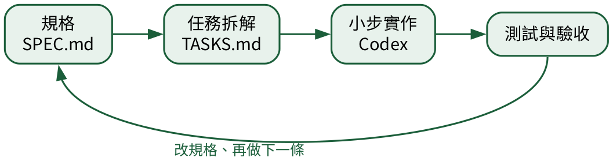
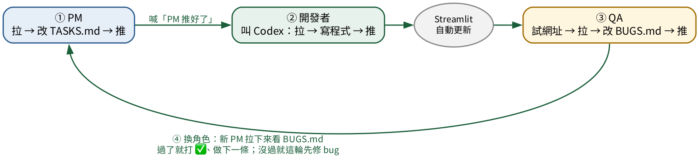

#+TITLE: Vibe Coding 第 2 週：照規格，用 Codex 重做一次
#+AUTHOR: 顏永進
#+SUBTITLE: SPEC → TASKS → 小步實作 → 驗收 · GitHub 協作
#+LANGUAGE: zh-TW
#+OPTIONS: toc:2 ^:nil num:t
#+PROPERTY: header-args :eval never-export
#+HTML_HEAD: <link rel="stylesheet" type="text/css" href="../css/muse.css" />
#+HTML_HEAD_EXTRA: 

* 老師用：本週流程 :noexport:
| 節次   | 時間  | 段落                                      | 對應章節 |
|--------+-------+-------------------------------------------+----------|
| 第 1 節 | 0–10  | 回顧四步循環；SPEC 點評與修訂（PM 在 GitHub 網頁改 SPEC.md） | 一 |
|        | 10–15 | 分工確認（上週已分過，這週每輪輪換）      | 二       |
|        | 15–20 | 回到上週的 repo：登入、拉最新版           | 三       |
|        | 20–35 | 開發者、PM、QA 各推一次（班規／任務／驗收紀錄） | 四   |
|        | 35–50 | 小步實作第 1 輪（順便部署）               | 五       |
| 第 2 節 | 0–30  | 小步實作第 2～3 輪                        | 五       |
|        | 30–42 | 交叉驗收（交換→驗收→回饋→推回自己的 repo） | 六    |
|        | 42–50 | 回顧：跟上週的版本差在哪；繳交            | 七、八   |

repo、邀請、clone、接力已在第 1 週暖身做過。時間不夠時的取捨：實作少跑一輪；交叉驗收不能砍。

** 課前準備
- *電腦教室* （403，Mac mini，學生共用 =student= 帳號）：
  - git、codex、node、python3 都有；student 帳號的 streamlit 已由 LabCtl 32 號範本裝好（33 號驗收）。
  - *每台的 python3 不一樣* （11/26 實測）：Mini01 是 =/usr/local/anaconda3/bin/python3= （3.12.7，streamlit 1.37.1）；
    Mini20 是 =/usr/bin/python3= （3.9.6，streamlit 1.50.0），而且沒有 =streamlit= 指令、沒有 =/usr/local/bin/python3= 。
    兩台 =python3 -m streamlit= 都能跑——講義一律用這個寫法，PyCharm 不指定固定的直譯器路徑。
  - gh 已裝好（第 1 週暖身已用過）。
- *Codex 登入* ：確認每台都已登入、額度夠用（一組至少一台能用就能上課）。
- *夥伴組名單* ：沿用第 1 週暖身的配對（見第二章）。
- *SPEC 範例* ：從各組 repo 裡的 SPEC.md 挑一份「驗收條件寫得模糊」的，第 1 節點評用（先徵求該組同意或匿名）。
- *Padlet* ：在最右邊加一欄「🔁 Codex 版還有這個問題嗎？」，第 2 節回顧用。
- *下課前* ：共用帳號會把登入資訊留給下一位——提醒學生執行 =gh auth logout= ；
  用自己的 ChatGPT 帳號登入 Codex 的，再執行 =codex logout= 。

** 人數不同的處理（摘要）
| 組員數 | 角色怎麼分                                   | push／pull 怎麼練                                  |
|--------+----------------------------------------------+----------------------------------------------------|
| 3 人   | PM／開發者／QA 各一人，每輪輪換              | PM 手動推 TASKS.md、開發者叫 Codex 推、QA 手動推 BUGS.md |
| 2 人   | 一人兼 PM＋QA、一人當開發者，每輪互換        | 同上，PM＋QA 那位每輪推兩次                        |
| 1 人   | 自己兼 PM＋開發者； *QA 由夥伴組的人擔任*     | 夥伴把 BUGS.md 推進你的 repo，你拉下來修          |

* 一、回顧與 SPEC 修訂
** 上週我們學到的四步循環
#+ATTR_HTML: :width 800

上週的 ChatGPT 版，我們是「想到什麼就叫 AI 做什麼」。
這週同一個題目——班級飲料團購統計 App—— *照這四步重做一次* ，最後比較兩個版本。

** SPEC 點評：這條驗收條件 AI 看得懂嗎？
拿一份 SPEC.md 來看，每條驗收條件問三個問題：
1. *照著做得出來嗎？* 有沒有寫「按哪裡、輸入什麼」？
2. *判斷得了嗎？* 做完能不能明確說「過」或「不過」？
3. *AI 會不會誤會？* 換一個完全不認識你們的人來讀，會做出一樣的東西嗎？

| 原本寫的       | 問題             | 改成                                               |
|----------------+------------------+----------------------------------------------------|
| 要能記錄訂單   | 記錄哪些欄位？   | 填姓名、飲料、甜度、冰塊、金額後按送出，表格多一筆 |
| 統計正確       | 怎樣算正確？     | 新增 3 筆 50 元，總杯數顯示 3、總金額顯示 150      |
| 資料不會不見   | 什麼情況不見？   | 重新整理頁面後，剛剛的訂單都還在                   |
| 介面友善       | 無法判斷         | （刪掉，或改成具體的：「手機直向不用左右捲動」）   |

** 各組修訂（5 分鐘）
PM 在 GitHub 網頁上打開 =SPEC.md= → 鉛筆 ✏️ 直接改 → *Commit changes* 。
- 必要功能超過 4 項？砍到 4 項。
- 驗收條件裡還有「能用」「正確」「友善」？改成可操作、可判斷的句子。
- 「畫面與資料」寫了資料存在哪、其他人看不看得到嗎？
  沒想好的話，最簡單的做法是： *由一個人負責收單，最後按「匯出 CSV」* ，
  並把「多人同時線上填單」寫進不做清單。
- 定位還是「班級自己用、一次一團、一家店」嗎？店家端的功能放進不做清單。
- 不做清單至少 3 條。

* 二、這週的分工
** 三個角色，各管各的檔案
上週暖身已經分過角色、跑過一次接力；這週照同樣的分工， *每輪輪換* 。
每個人都在自己的電腦上做事，透過 GitHub 交接。
每個角色只改自己負責的檔案，改完自己推上去：

| 角色   | 做什麼                                       | 負責的檔案             | 怎麼推       | 不能做的事                     |
|--------+----------------------------------------------+------------------------+--------------+--------------------------------|
| PM     | 決定這輪做哪一條、把驗收條件寫清楚           | =TASKS.md= 、 =SPEC.md= | *自己打指令* | 不能寫程式、不能指揮 Codex     |
| 開發者 | *唯一指揮 Codex 的人* ：下任務、讀回報       | =app.py= 等程式、 =AGENTS.md= | 叫 Codex 推  | 不能自己決定做什麼、不改其他 .md |
| QA     | 打開網址照驗收條件試，再亂試三種；記錄結果   | =BUGS.md=               | *自己打指令* | 不能看程式碼、不能改程式       |

目的是讓每個人都體會到： *寫程式已經不是瓶頸，想清楚和驗收才是* 。

** 人數不同怎麼分
| 組員數 | 怎麼分                                              | 每輪誰推什麼                                  |
|--------+-----------------------------------------------------+-----------------------------------------------|
| 3 人   | 一人一角，每輪輪換                                  | PM 推 TASKS.md → 開發者推程式 → QA 推 BUGS.md |
| 2 人   | 一人兼 PM＋QA，另一人當開發者；每輪互換              | 同上，PM＋QA 那位推兩次                       |
| 1 人   | 自己兼 PM＋開發者， *QA 由夥伴組的人擔任*            | 你推 TASKS.md 和程式 → 夥伴推 BUGS.md 進你的 repo |

1 人組的提醒：
- 老師會把 1 人組和其他小組配成「夥伴組」，互相當對方的 QA。組長邀請時，記得把夥伴也加成 Collaborator。
- 一個人也要守規矩：先當 PM 改好 TASKS.md 推上去，再換開發者的帽子叫 Codex 做；
  推上去之後， *不准自己驗收* ，等夥伴來試。

為什麼 QA 一定要是別人？因為上週互打 App 已經看到了：
*自己覺得做完了，別人一用就發現你沒想到的地方* 。

* 三、GitHub 協作：回到上週的 repo
** 重新登入、拉最新版（約 5 分鐘）
repo、邀請上週暖身都做過了。這週每個人只要：

*1. 重新登入* （單獨執行這一行，等它說登入成功）
#+begin_src sh
gh auth login
#+end_src
看最後一行 =Logged in as ...= *是不是你自己的帳號* ；不是的話，
到瀏覽器把 GitHub 登出 → =gh auth logout= → 重新登入。

*2. 拿到最新版*
- 桌面上 *還有* 上週的資料夾：
  #+begin_src sh
  cd ~/Desktop/c1-g3-drink           # 換成你們上週的資料夾名字
  git pull                           # 拿到 PM 回家改好的 SPEC.md
  #+end_src
- 資料夾 *不見了* （學校電腦會清桌面，或你換了座位）：照第 1 週的步驟 5、6 重新 clone、設定 =git config= 。

*3. 用 PyCharm 打開專案* ： *Open* → 選你們的資料夾 → 跳出「Trust and Open Project?」按 *Trust Project* 。
之後看檔案、改檔案都在 PyCharm，指令在 PyCharm 下方的 *Terminal* 打。

- 確認一下：資料夾裡的 =SPEC.md= 是團購規格，不是暖身規格。

** PM、QA：自己動手的四步
PM 和 QA 只改 .md 檔，不用 Codex，自己來。跟上週暖身一樣： *檔案在 PyCharm 改，git 指令在 PyCharm 的 Terminal 打* 。

1. *先拉最新版* （Terminal）
   #+begin_src sh
   git pull
   #+end_src
2. *在 PyCharm 改檔案* ：左邊點 =TASKS.md= （QA 點 =BUGS.md= ）直接改，PyCharm 會自動存檔。
   右上角可以切換 Markdown 預覽。
3. *存檔點* （Terminal）
   #+begin_src sh
   git add TASKS.md                  # QA 換成 BUGS.md
   git commit -m "PM：這輪做 T3"     # 引號裡寫你做了什麼
   #+end_src
4. *推上去* （Terminal）
   #+begin_src sh
   git push
   #+end_src

不確定改了什麼？ =git status= 會列出哪些檔案動過。

** 選用：連 git 也用 PyCharm 的按鈕
不想打 git 指令的 PM、QA，可以用 PyCharm 的選單做同樣的事（可以和指令混著用）：

| 動作       | Terminal 指令           | PyCharm 按鈕                                              |
|------------+-------------------------+-----------------------------------------------------------|
| 拉最新版   | =git pull=              | 左上角專案名旁的 Git 選單 → *Update Project* （ =⌘T= ）    |
| 存檔點＋推 | =git add／commit／push= | =⌘K= → 只勾你的檔案、寫訊息 → *Commit and Push*           |
| 看歷史     | =git log=               | =⌘9= 開 Git 視窗 → Log                                    |

- Commit 視窗 *只勾你負責的檔案* （PM 勾 TASKS.md，QA 勾 BUGS.md），不要勾 =.idea= 之類的東西。
- 登入 GitHub 一樣靠 =gh auth login= ；作者一樣靠第 1 週步驟 6 的 =git config= 。

** 開發者：交給 Codex 的四句話
開發者在 PyCharm 的 Terminal 輸入 =codex= 啟動，git 的事都請 Codex 代勞：

| 你想做的事             | 對 Codex 說                               |
|------------------------+-------------------------------------------|
| 開工前，拿組員的新版   | 「先 git pull」                           |
| 做完一條任務，送上去   | 「commit，訊息寫『T3 完成』，然後 push」  |
| 看看大家改了什麼       | 「用 git log 列出最近五個 commit，誰做的、改了什麼」 |
| 改壞了，想回到上一版   | 「還沒 commit 的修改全部丟掉，回到上一個 commit」 |

Codex 要執行 git 指令前會先問你同意—— *看一眼它要跑什麼再按同意* 。
你會發現它跑的，就是 PM、QA 自己打的那幾行。

** 不打架：接力棒規則
兩個人同時改同一個檔案，git 會「打架」（衝突，conflict）。用三條規則避開：
1. *每個檔案只有一個主人* （見第二章的表），不碰別人的檔案。
2. *接力棒：同一時間只有一個人在推* 。推好了要 *喊出來* （「PM 推好了！」），下一位才動手。
3. *動手前一定先拉* 。沒拉就改，等於在舊版本上改。

真的打架了？開發者跟 Codex 說「git pull 時有衝突（conflict），先告訴我兩邊差在哪，再幫我解決」；
PM、QA 遇到就找開發者或老師。

* 四、開工前：立班規、拆任務（三個人各推一次）
** ① 開發者：建班規、拆任務，推上去
在 Codex 裡：
1. 「先 git pull。」SPEC.md 已經是 PM 改好的團購規格；
   =app.py= 是上週暖身做的點單畫面， *留著當起點* ，之後照 TASKS.md 一條一條加。
2. 請 Codex 建立 =AGENTS.md= （內容見下一頁）。
3. 請 Codex 拆任務：
#+begin_example
讀 SPEC.md 和 app.py（上週已做好點單畫面），把還沒做的必要功能拆成 5～8 條任務，寫進 TASKS.md。
每條任務用下面的格式，編號 T1、T2……，按照先後順序排列。不要開始寫程式。

## T1 任務名稱（一句話）
- 驗收條件：……
- 狀態：待做
#+end_example
4. 「commit，訊息寫『班規、任務清單』，然後 push」→ 喊「開發者推好了」。

** AGENTS.md：Codex 的班規
Codex 每次啟動都會自動讀專案資料夾裡的 =AGENTS.md= ：
#+begin_src markdown
# 班規
- 一律用繁體中文回答，用高中生聽得懂的話
- 動手前先讀 SPEC.md，只做 TASKS.md 裡「狀態：▶ 這輪做」的那一條
- 一次只改一件事，改完告訴我改了哪些檔案、為什麼
- SPEC.md 第 5 欄「不做清單」列的功能，就算你覺得有用也不要做；想加功能先問我
- 主程式放在 app.py；計算總杯數、總金額的部分寫成獨立的函式
- 除了 streamlit，不安裝任何套件，除非我同意；需要的套件寫進 requirements.txt
- 菜單和價格放在 menu.json，程式從檔案讀，不要寫死在 app.py 裡
- 密碼一律放 st.secrets，不寫進程式或任何會推上 GitHub 的檔案；不做帳號登入系統
- 不要建立虛擬環境（venv），直接用系統的 python3；在本機試跑一律用 python3 -m streamlit run app.py
- 建立 .gitignore，排除 .idea/、.venv/、__pycache__/、.DS_Store
- 我說 commit 才 commit，我說 push 才 push；commit 訊息用繁體中文
- 不要修改 SPEC.md、TASKS.md、BUGS.md（那是 PM 和 QA 的檔案）
#+end_src
概念：AGENTS.md 是「每次 AI 犯錯，就加一條規則」的地方。今天結束前，班規應該會長出新的幾條。

為什麼要寫 =python3 -m streamlit= ？學校電腦的 streamlit 裝在 student 帳號裡，
直接打 =streamlit= 可能會「找不到指令」，透過 =python3 -m= 一定找得到。
（在家裡自己的電腦：通常要先建 venv，再 =pip install -r requirements.txt= ，見附錄。）

為什麼密碼要放 =st.secrets= ？repo 是 Public， *寫在程式裡的密碼全世界都看得到* 。
要做「團主密碼」（例如輸入密碼才看得到「關閉收單」）的組：
到 Streamlit 的 *Manage app → Settings → Secrets* 填一行 =團主密碼 = "xxxx"= ，
程式用 =st.secrets["團主密碼"]= 讀。這不是帳號系統，只是「知道密碼的人看得到團主按鈕」。

** ② PM：審任務清單，推上去
1. =git pull= ，在 PyCharm 點開 TASKS.md，全組一起看：
   - 順序對嗎？點單畫面上週做好了，T1 應該是「送出後記下這筆、列在表格裡」，不是「匯出 CSV」。
   - 有沒有一條其實是三條？一條任務的標準： *10 分鐘內做得完、QA 驗得了* 。
2. 自己動手改（拆開、調順序、把驗收條件寫清楚），再把 T1 的狀態改成 =▶ 這輪做= 。
3. =git add TASKS.md= → =git commit -m "PM：審任務，這輪做 T1"= → =git push= → 喊「PM 推好了」。

** ③ QA：建 BUGS.md，推上去
1. =git pull= ，確認資料夾裡有 SPEC.md、AGENTS.md、TASKS.md。
2. 在 PyCharm 點開 =BUGS.md= ，把上週暖身的紀錄刪掉，只留第一行：
   #+begin_src markdown
   # 驗收紀錄
   #+end_src
3. =git add BUGS.md= → =git commit -m "QA：清空驗收紀錄"= → =git push= → 喊「QA 推好了」。

三個人都推過一次了——跟上週暖身一樣： *改自己的檔案、推上去、下一位拉下來* 。

* 五、小步實作循環
** 每一輪的流程（約 12 分鐘）
#+begin_src dot :file images/week2-round.png :exports results
digraph round {
  rankdir=LR; bgcolor="transparent"; dpi=150; nodesep=0.35; ranksep=0.5; forcelabels=true;
  node [shape=box, style="rounded,filled", penwidth=1.5, fontname="Noto Sans CJK TC", fontsize=13, margin="0.15,0.08"];
  edge [color="#1b5e3a", penwidth=1.5, fontname="Noto Sans CJK TC", fontsize=11, fontcolor="#1b5e3a"];
  pm  [label="① PM\n拉 → 改 TASKS.md → 推", fillcolor="#e6eef8", color="#2a5a8c"];
  dev [label="② 開發者\n叫 Codex：拉 → 寫程式 → 推", fillcolor="#e8f2ec", color="#1b5e3a"];
  st  [label="Streamlit\n自動更新", shape=ellipse, fillcolor="#f2f2f2", color="#888888", fontsize=11];
  qa  [label="③ QA\n試網址 → 拉 → 改 BUGS.md → 推", fillcolor="#fff6e0", color="#a06a00"];
  pm -> dev [label="喊「PM 推好了」"];
  dev -> st -> qa;
  qa:s -> pm:s [xlabel="④ 換角色：新 PM 拉下來看 BUGS.md\n過了就打 ✅、做下一條；沒過就這輪先修 bug", constraint=false];
}
#+end_src

#+ATTR_HTML: :width 800
#+RESULTS:

** 每一步誰做什麼
| 步驟 | 誰     | 做什麼                                                                                   |
|------+--------+------------------------------------------------------------------------------------------|
| ①    | PM     | =git pull= ；看 BUGS.md：上一條過了就把狀態改成 =✅ 完成= ，下一條改成 =▶ 這輪做= ；       |
|      |        | 沒過就把那一條改成 =▶ 這輪做（修 B1）= 。存檔、 =git add/commit/push= ，喊「PM 推好了」 |
| ②    | 開發者 | 對 Codex：「先 git pull」→「讀 SPEC.md 和 AGENTS.md，完成 TASKS.md 裡『▶ 這輪做』的那一條」 |
|      |        | 讀 Codex 的回報， *用自己的話* 跟組員說它改了什麼                                         |
|      |        | 對 Codex：「commit，訊息寫『T3 完成』，然後 push」，喊「開發者推好了」                                |
| ③    | QA     | 等網站更新（約 1 分鐘），照驗收條件試，再亂試三種                                        |
|      |        | =git pull= ，在 BUGS.md 寫下結果（通過或 bug），存檔、 =git add/commit/push= ，喊「QA 推好了」 |
| ④    | 全組   | 換角色（PM→開發者→QA→PM），從 ① 開始                                                   |

** TASKS.md 長這樣（PM 只改「狀態」那一行）
#+begin_src markdown
## T1 畫面：標題＋點單表單
- 驗收條件：打開網址看得到姓名、飲料、甜度、冰塊、金額欄位和「送出」按鈕
- 狀態：✅ 完成

## T2 送出後表格多一筆
- 驗收條件：填好按送出，下方表格多一筆，欄位內容正確
- 狀態：▶ 這輪做

## T3 統計總杯數、總金額
- 驗收條件：新增 3 筆 50 元，顯示總杯數 3、總金額 150
- 狀態：待做
#+end_src

** BUGS.md 怎麼寫（QA）
#+begin_src markdown
# 驗收紀錄

## T1：通過

## T2：沒過 → B1
- 我做了什麼：金額填 -50，按送出
- 我預期：跳出提示，不新增訂單
- 實際發生：新增成功，總金額變少 50 元
#+end_src
下一輪的 PM 看到 B1，就把 T2 改成 =▶ 這輪做（修 B1）= ；
開發者跟 Codex 說：「先 git pull，修正 BUGS.md 的 B1」。

（1 人組：你的 QA 夥伴用一樣的方式，把 BUGS.md 推進你的 repo。）

** 第 1 輪多做一件事：部署到 Streamlit
T1 推上去之後，由 *組長* 部署一次，之後每次推上去網站都會自動更新：
1. 打開 [[https://share.streamlit.io][share.streamlit.io]]（用上週那個帳號登入）→ *Create app* 。
2. 選 *Deploy a public app from GitHub* ，Repository 選 =drink-app-v2= ，
   Main file path 填 =app.py= 。
3. App URL 取一個好認的名字，例如 =drink-v2-group3= → *Deploy* 。
4. 把網址貼在組內，QA 從此只看這個網址。

上週的 ChatGPT 版網址 *不要刪* ，最後要拿來比較。

** 老師巡視重點 :noexport:
- PM、QA 有沒有自己打 git 指令？還是偷偷叫開發者代推？
- 有沒有人沒拉就改，或推好沒喊、下一位提早動手？
- 開發者有沒有跳過「用自己的話說明」？
- QA 有沒有偷看程式碼？有沒有人在 QA 的電腦上改 app.py？
- 有沒有組一次丟兩條任務給 Codex？
- Codex 改了 TASKS.md 或 BUGS.md？那就是該加進 AGENTS.md 的新班規。

* 六、交叉驗收（12 分鐘）
** 規則
兩組互測（老師配對），只拿對方的 *SPEC.md* 和 *App 網址* ：
- *只看規格* ，照對方的驗收條件一條一條試。
- 不看程式碼，不問對方「這個要怎麼用」——照規格做不出來，就是 *規格的問題* 。

** 流程
| 步驟         | 時間   | 做什麼                                                                 |
|--------------+--------+------------------------------------------------------------------------|
| 1. 交換網址  | 1 分鐘 | 給對方兩個網址： *GitHub repo* （在網頁上讀 SPEC.md，不用 clone）＋ *Streamlit 網址* |
| 2. 驗收      | 7 分鐘 | 照對方的驗收條件一條一條試，填驗收表；再跑 QA 題庫四題                 |
| 3. 回饋      | 2 分鐘 | 兩組面對面，各說一條「失敗」（給開發者）、一條「規格寫不清楚」（給 PM） |
| 4. 收尾再推一次 | 2 分鐘 | 被測組的 QA、PM 把對方的回饋寫進自己的檔案，推上去                    |

** 驗收時組內怎麼分
| 工作   | 做什麼                                         |
|--------+------------------------------------------------|
| 唸規格 | 在 GitHub 網頁打開對方的 SPEC.md，一條一條唸出驗收條件 |
| 操作   | *只照唸出來的內容* 操作對方的 App                |
| 記錄   | 在驗收表勾「通過／失敗／規格寫不清楚」，失敗的寫下實際發生什麼 |
2 人組：一人唸＋記錄、一人操作。1 人組：自己操作、自己記錄。

驗收條件試完，再跑上週 QA 題庫的 *A1～A6* ，
以及 *對方 SPEC 有寫要做* 的 B 題（SPEC 沒寫的 B 題，沒做到不算錯）。

** 驗收表
受測組：＿＿＿＿　驗收組：＿＿＿＿

| # | 驗收條件（抄對方 SPEC） | 通過 | 失敗 | 規格寫不清楚 | 實際發生什麼 |
|---+-------------------------+------+------+--------------+--------------|
| 1 |                         |      |      |              |              |
| 2 |                         |      |      |              |              |
| 3 |                         |      |      |              |              |
| 4 |                         |      |      |              |              |
| 5 |                         |      |      |              |              |
| 6 |                         |      |      |              |              |
| 題庫 | A1～A6＋SPEC 有寫的 B 題 |  |      |              |              |
「規格寫不清楚」是給 *PM* 的回饋，不是給程式的。

** 收尾：把回饋推進自己的 repo
聽完對方的回饋，被測組（你們自己）：
- *QA* ：把對方抓到的失敗抄進 =BUGS.md= ，標上來源，然後推上去：
  #+begin_src markdown
  ## B5（交叉驗收，第 4 組抓到）
  - 我做了什麼：……
  - 我預期：……
  - 實際發生：……
  #+end_src
- *PM* ：把「規格寫不清楚」的那條驗收條件改清楚，推上去。

這些 bug 課堂上來不及修，留作回家作業，也是下一段「兩個版本差在哪」的討論素材。

** 老師配對注意 :noexport:
- 12 組配成 6 對（A 測 B、B 測 A）；組數不是偶數時排成三角（A→B→C→A）。
- *不要和夥伴組配在一起* ：1 人組的夥伴當過他們的 QA，太熟悉那個 App，測不出問題。
- 配對表課前公布，或投影在畫面上。

* 七、回顧：兩個版本差在哪
** 回到 Padlet
打開 Padlet 最右邊新的一欄「🔁 Codex 版還有這個問題嗎？」，各組貼一張：
- 上週 🧋、❓ 欄那些問題，這週還有嗎？（只算你們 SPEC 寫了要做的）
- 如果還有，是哪一步沒做好？（規格沒寫？驗收沒試？）

** 三個問題（每組 1 分鐘）
1. 跟上週的 ChatGPT 版相比，這次哪裡不一樣？
2. Codex 犯過什麼錯？你們加了哪一條班規？
3. 壞掉的時候，這次知不知道要退回哪裡？

** 帶走一句話
#+begin_quote
你的價值從「寫程式」，移到了「說清楚、拆小、驗收」。
#+end_quote
這套流程也是專題企劃書、科展計畫書的骨架：給誰用、做什麼、不做什麼、怎樣算成功。

* 八、繳交
每組填 Google 表單（老師另發）：
| 項目                        | 說明                                          |
|-----------------------------+-----------------------------------------------|
| GitHub repo 網址            | =drink-app-v2= ，要看得到每個人的存檔點        |
| Streamlit 網址（Codex 版）  | 能打開、能用                                  |
| 交叉驗收表                  | 拍照或截圖                                    |
| 個人反思（每人）            | 兩個版本差在哪？你當三種角色時各有什麼體會？  |

下課前： *學校電腦是大家共用的* ，不登出的話，下一位同學就能用你的帳號推東西。
#+begin_src sh
gh auth logout     # 登出 GitHub
codex logout       # 如果你是用自己的 ChatGPT 帳號登入 Codex
#+end_src
瀏覽器裡的 GitHub（和 ChatGPT）也要登出，不然下一位 =gh auth login= 會直接登入成你。

* 附錄：GitHub 急救 :noslide:
| 狀況                                            | 解法                                                                 |
|-------------------------------------------------+----------------------------------------------------------------------|
| push 被拒絕（ =rejected= 、 =fetch first= ）     | 有人先推了：先 =git pull= 再 =git push=                              |
| =git pull= 時出現衝突（ =CONFLICT= ）            | 叫 Codex 先說明兩邊差在哪，再幫你解決；看不懂就找老師                |
| =Permission denied= 、 =403=                    | 還沒接受邀請，或還沒 =gh auth login= ；確認組長有加你當 Collaborator |
| =gh: command not found=                         | 這台還沒裝 gh：請老師在 LabCtl 對這台跑 36 號範本                    |
| push 時終端機要你輸入 Username／Password        | 沒用 gh 登入：按 =Ctrl-C= ，先跑 =gh auth login= （選 Yes 讓 git 用 GitHub 帳號） |
| GitHub 上存檔點的作者顯示 =student=             | 忘了第 1 週步驟 6：在專案資料夾設 =git config user.name／user.email= ，之後的存檔點就對了 |
| =fatal: destination path ... already exists=    | 這個資料夾名字別人用過了：clone 時換一個名字（加班級組別）           |
| 一打開就是上一位同學的 GitHub／Codex 帳號        | 上一位沒登出：先 =gh auth logout= 、 =codex logout= ，再用自己的帳號登入 |
| clone 時說 =Repository not found=               | 網址打錯、或 repo 是 Private 而你還沒被邀請                          |
| 推上去了，Streamlit 網站沒變                    | 等 1～2 分鐘；還是沒變，到 Streamlit 的 *Manage app* 看紅字           |
| Streamlit 出現 =ModuleNotFoundError=            | 缺 requirements.txt：叫 Codex 補上並推上去                           |
| 本機跑 App 時 =streamlit: command not found=    | 改用 =python3 -m streamlit run app.py=                               |
| =error: externally-managed-environment=         | 想用 pip 裝套件被擋：在學校不要自己裝，告訴老師；在家用 venv（見下方） |
| PyCharm 跳出「建立虛擬環境」                    | 按取消就好；學校電腦已裝好 streamlit，用 =python3 -m streamlit run app.py= 跑 |
| Commit 視窗出現一堆 =.idea= 、 =.venv= 檔案     | 不要勾；叫開發者請 Codex 補 .gitignore                               |
| 改壞了                                          | 對 Codex：「還沒 commit 的修改全部丟掉，回到上一個 commit」          |
| Codex 說額度用完（usage limit）                 | 換人登入接力，見下方「Codex 額度用完：換人接力」                     |

** Codex 額度用完：換人接力
進度存在 *檔案和 git* 裡，不在 Codex 的對話裡——換一個人登入，讀完 SPEC.md、TASKS.md、AGENTS.md 就能接著做。

*1. 先處理改到一半的程式* （額度用完，Codex 不能幫你跑 git，自己打）
#+begin_src sh
git status                     # 看 Codex 改了哪些檔案
#+end_src
- 改得差不多了 → 自己存檔推上去：
  #+begin_src sh
  git add app.py
  git commit -m "T3 做到一半（額度用完，換人接）"
  git push
  #+end_src
- 改壞了、看不懂改了什麼 → 丟掉，回到上一個存檔點： =git restore .=

*2. 換人登入* （二選一）
- *同一台電腦* ： =codex logout= → =codex login= ，用另一位組員的 ChatGPT 帳號在瀏覽器登入。
- *換到另一位組員的電腦* ：那台先 =git pull= ，再啟動 =codex= 。順便換人當開發者。

*3. 對新的 Codex 說*
#+begin_example
先執行 git status 和 git log -3，看上一個人做到哪。
再讀 AGENTS.md 和 TASKS.md，繼續做「▶ 這輪做」那一條。
#+end_example

注意：
- *換電腦前一定要先 push* ，沒推上去的修改只在原本那台。
- 同一台換帳號，可以試試 =codex resume= 接回舊對話；接不上就照第 3 步開新對話。
- 共用 student 帳號：換人登入後，下課前一樣要 =codex logout= ，不然下一位會用到這個人的額度。
- *1 人組* ：請夥伴組的人用他自己的帳號登入幫忙；或先停下 Codex，這段時間當 QA 驗收、寫 BUGS.md。

** 在家裡自己的電腦跑 clone 下來的專案
clone 下來只有程式碼， *沒有套件* （ =.venv= 不會推上 GitHub）。第一次要：
#+begin_src sh
cd 專案資料夾
python3 -m venv .venv               # 建一個這個專案專用的 Python 環境
.venv/bin/pip install -r requirements.txt   # 照清單裝套件
.venv/bin/python -m streamlit run app.py    # 跑起來
#+end_src
看到 =externally-managed-environment= 就是忘了用 venv 裡的 pip。
不要照錯誤訊息加 =--break-system-packages= ，那會把套件硬塞進系統的 Python。
